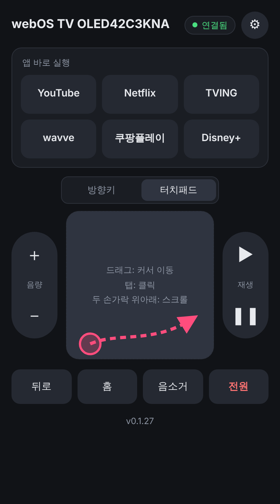
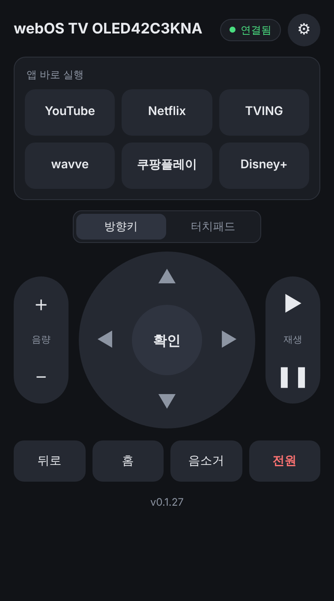
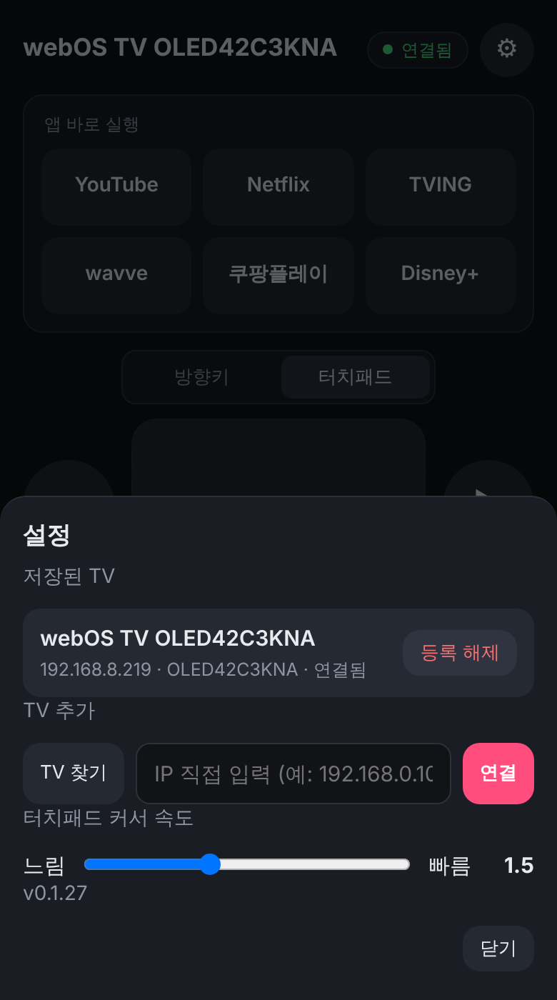
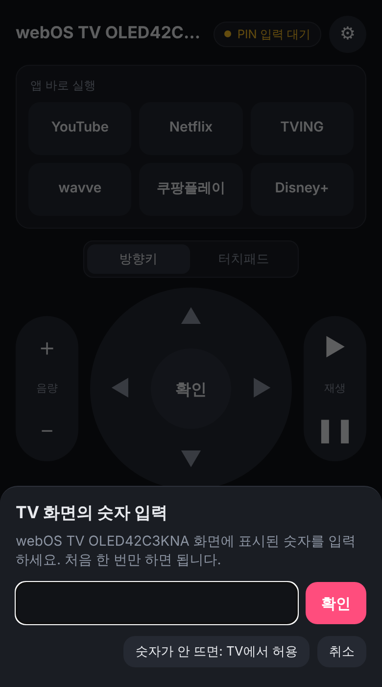

# smart-tv-remocon

휴대폰으로 스마트 TV(우선 **LG webOS**)를 조작하는 안드로이드 앱.
IR(적외선)이 아니라 TV가 열어 둔 **네트워크 제어 API**(`wss://TV:3001`)를 쓴다.

> ### 👆 화면을 손가락으로 밀면 TV 커서가 따라 움직입니다
> **터치패드 모드**에서 폰 화면을 드래그하면 LG 매직 리모컨처럼 TV의 커서가 이동하고,
> **탭하면 클릭**, **두 손가락으로 위아래로 밀면 스크롤**됩니다. 방향키로 한 칸씩 옮길 필요가 없습니다.

<table>
<tr>
<td align="center" width="50%"><b>터치패드 모드</b>  <b>드래그 = 커서 이동</b> 탭 = 클릭 · 두 손가락 = 스크롤</td>
<td align="center" width="50%"><b>방향키 모드</b>  방향키·확인 길게 누르면 반복</td>
</tr>
<tr>
<td align="center" width="50%"><b>⚙ 설정</b>  저장된 TV · TV 찾기 IP 입력 · 커서 속도</td>
<td align="center" width="50%"><b>첫 연결 (PIN)</b>  TV 화면의 숫자를 숫자판으로 (리모컨 불필요)</td>
</tr>
</table>

이미지는 앱의 실제 화면 파일(`app/src/main/assets/index.html`)을 예시 TV 데이터로 렌더링한 것. 터치패드 그림의 분홍 화살표는 손가락 드래그를 표시하기 위해 덧그린 것이다.

## 기능

### 터치로 커서 이동 (터치패드 모드)
가운데 칸을 **[방향키 | 터치패드]**로 전환한다 (마지막 선택을 기억).

| 동작 | TV에서 | 비고 |
|---|---|---|
| 한 손가락 드래그 | 커서 이동 | 빨리 밀수록 멀리 감. 속도는 ⚙에서 조절 (기본 1.5) |
| 탭 | 커서 위치 클릭 | TV가 단독 클릭을 무시해서 살짝 이동 후 클릭 (실TV 확인) |
| 두 손가락 위아래 | 스크롤 | 아래로 끌면 위쪽 내용 (폰 스크롤과 같은 느낌) |
| 확인 버튼 | 커서가 보이면 커서 위치 선택 | 매직 리모컨과 동일 |

### 리모컨
- 앱 바로 실행: YouTube · Netflix · TVING · wavve · 쿠팡플레이 · Disney+
- 볼륨 +/−(길게 누르면 반복) · 음소거 · 재생/일시정지
- 방향키 · 확인 · 뒤로 · 홈
- 전원 끄기 (실수 방지로 두 번 눌러야 꺼짐)

### 연결
- **자동 찾기**: 켜면 마지막 TV에 바로 연결, 처음이면 같은 네트워크에서 TV를 찾는다 (SSDP, IP 입력 불필요)
- **첫 등록은 PIN**: TV 화면에 뜬 숫자를 앱의 **숫자판(0~9)**으로 입력 — 리모컨이 없어도 되고 키보드도 안 뜬다. 숫자가 안 뜨는 TV는 'TV에서 허용' 방식으로 전환
- 한 번 등록하면 다음부터 자동 연결. TV IP가 바뀌어도 TV 고유값(uuid)으로 같은 TV를 알아본다
- ⚙ 설정: 저장된 TV 연결 · 등록 해제(두 번 눌러) · TV 찾기 · IP 직접 입력 · 커서 속도

## 실제 TV 확인 현황 (LG OLED42C3KNA, 2026-10-19)

| 항목 | 결과 |
|---|---|
| 자동 찾기(SSDP), PIN 등록 | ✅ |
| 앱 실행, 볼륨, 음소거, 재생/정지, 전원 끄기 | ✅ |
| 방향키 · 확인 · 뒤로 · 홈 | ✅ |
| 커서 이동 · 클릭 · 스크롤 (확인 도구) | ✅ |
| 터치패드 모드 (앱) | 확인 중 |

자세한 프로토콜과 확인 방법은 [WEBOS_API.md](WEBOS_API.md).

## 설치
`main`에 push하면 GitHub Actions가 **단위 테스트 후** APK를 빌드한다.
Actions 실행 화면 → Artifacts → `smart-tv-remocon-release-N.apk`.
고정 키로 서명되므로 새 버전은 덮어쓰기로 설치된다.

## 확인용 도구 (`tools/`, Python 표준 라이브러리만 — pip 설치 불필요)
PC나 안드로이드 Pydroid 3(무료, 시작 시 Premium 화면은 닫으면 됨)에서 실행한다.

| 도구 | 용도 |
|---|---|
| `lg_tv_apps.py` | TV에 설치된 앱 이름·ID 출력, 번호로 실행. 등록 방식 선택(허용 / PIN) |
| `ssdp_find_tv.py` | 같은 네트워크의 LG TV를 찾아 IP·이름·모델 출력 (`all` 옵션: 모든 기기) |
| `lg_pointer_test.py` | 커서 이동·클릭·스크롤 형식 확인 (네모 그리기, d/a/w/s, wheel, click2) |

`https://TV_IP:3001`을 브라우저로 열어 `Hello world`가 나오면 TV 쪽은 준비된 것이다.

## 문서
- [ARCHITECTURE.md](ARCHITECTURE.md): 구조, 브리지 API, 저장 데이터, 위협 모델, 빌드·서명
- [WEBOS_API.md](WEBOS_API.md): 실TV에서 확인한 프로토콜·앱 ID (확인된 사실만)
